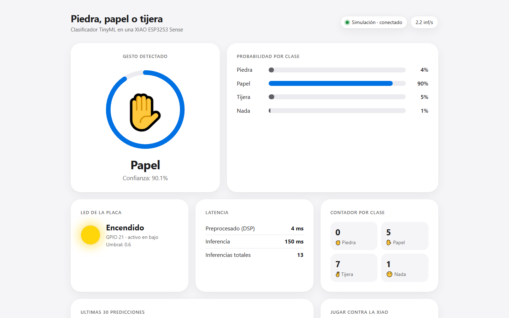

# tinyml-rps-xiao


Piedra, papel o tijera con TinyML (aprendizaje automático en microcontroladores): una XIAO
ESP32S3 Sense mira la mano, clasifica el gesto en la propia placa y enciende su LED cuando ve
`tijera` con más de 60 % de confianza. El modelo se entrena en Edge Impulse **por API**, sin clics
en el Studio, y un dashboard local muestra cada inferencia en vivo.

Curso Proyecto Integrador C7328, UPCH 2026-II.



## Flujo

```
fotos (CameraWebServer)          pipeline/preparar_dataset.py      pipeline/subir_edge_impulse.py
datos/crudas/<clase>/*.jpg  -->  datos/listo/{training,testing}  -->  Edge Impulse (Ingestion API)
                                                                              |
firmware/flashear  <--  firmware/compilar  <--  firmware/parchear_libreria.py  <--  pipeline/entrenar.py
      |                                                                          pipeline/descargar_libreria.py
      v
XIAO: una línea JSON por inferencia (docs/CONTRATO.md)  -->  dashboard/servidor.py --serial  -->  navegador
```

Clases: `piedra`, `papel`, `tijera`, `nada`. Contrato de datos entre placa, webcam y dashboard:
[docs/CONTRATO.md](docs/CONTRATO.md).

## Probarlo ya, sin placa

```bash
python -m venv .venv
.venv/Scripts/activate          # Windows (Git Bash); en macOS o Linux: source .venv/bin/activate
pip install -r requirements.txt
python dashboard/servidor.py --simular
# abrir http://127.0.0.1:5000
```

Pruebas: `python -m pytest -q`. Para correr también la prueba de cuantización con un modelo TFLite real: `pip install -r requirements-dev.txt`.

## Estructura

| Carpeta | Qué hay |
|---|---|
| [firmware/](firmware/README.md) | Parcheador de la librería de Edge Impulse (pines de la XIAO, LED en GPIO 21 activo en bajo, salida JSON), compilación y flasheo con `arduino-cli`. |
| [pipeline/](pipeline/README.md) | Preparación del dataset, subida y entrenamiento por API, descarga de la librería, inferencia local con webcam. |
| [dashboard/](dashboard/README.md) | Servidor Flask con SSE (eventos enviados por el servidor) y una página de un solo archivo, sin CDN. |
| [tests/](tests/) | Pruebas con `pytest`. |
| [resultados/](resultados/) | Capturas del dashboard, log de compilación y validación de la inferencia local. |
| [docs/](docs/) | Contrato JSON, guion de la demo, decisiones y lista de pendientes. |

## Lo que falta y depende del hardware

Ver [docs/PENDIENTES.md](docs/PENDIENTES.md): la lista exacta, en orden, de lo que hay que hacer
con la placa, las fotos y la clave de la API de Edge Impulse.

## Secretos

La clave de Edge Impulse va solo en `.env` (copia de `.env.example`), que está en `.gitignore`.
Ningún script la imprime completa.
