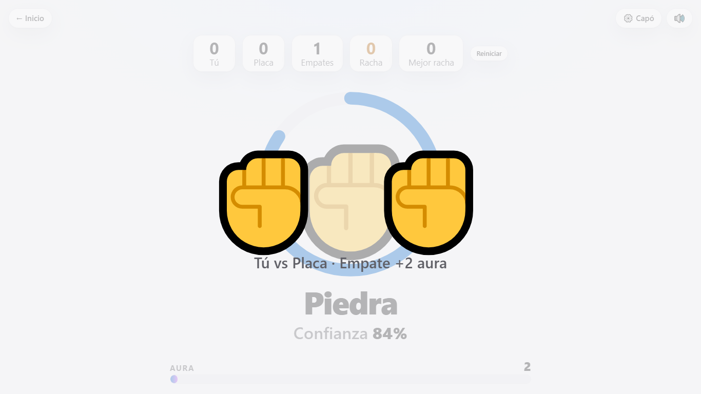

# Dashboard en vivo

Panel web para ver las inferencias del clasificador piedra, papel o tijera (XIAO ESP32S3 Sense). Un solo archivo HTML sin CDN ni fuentes externas, claro, oscuro y arcade, adaptado a celular.

## Ejecutar

Desde la raíz del repo (necesita `flask`; `pyserial` solo para el modo serie):

| Modo | Comando |
|---|---|
| Simulación (sin hardware) | `python dashboard/servidor.py --simular` |
| XIAO por USB | `python dashboard/servidor.py --serial COM5` (o define `XIAO_PUERTO` en `.env` y usa `--serial`) |
| Webcam | `python dashboard/servidor.py` y en otra terminal `python pipeline/inferencia_local.py --enviar http://127.0.0.1:5000` |

Opciones: `--puerto-http 5000`, `--host 127.0.0.1`, `--baudios 115200`. Abre `http://127.0.0.1:5000`.

Solo con `--simular`:

| Opción | Efecto |
|---|---|
| `--guion "piedra,papel:2,metal"` | Fuerza la secuencia de clases, cada elemento `clase` o `clase:segundos` (1.6 s por defecto). Sirve para probar los easter eggs. Al terminar vuelve al modo aleatorio. |
| `--guion-bucle` | Repite el guion sin parar. |
| `--led-clase tijera` | El LED simulado se enciende con esa clase (umbral 60 %). |
| `--led-clases "tijera,metal"` | Igual, pero con varias clases a la vez. |

Parámetros de la página: `?semilla=7` (azar reproducible) y `?rapido=1` (pausas cortas, para pruebas).

## Endpoints

- `GET /` : la página.
- `GET /api/stream` : SSE, evento `inferencia` y un latido cada 15 s.
- `GET /api/estado` : fuente, `puerto`, conexión, `clases` (las vistas hasta ahora), conteos por clase, última inferencia, latencia media y tiempo activo.
- `POST /api/inferencia` : una inferencia en JSON o una línea cruda; 400 si no cumple `docs/CONTRATO.md`.

## API de la página (`window.RPS`)

Los bloques del juego se enganchan a un objeto global pequeño:

- Datos: `RPS.clases` (de las claves de `probs`, primero piedra, papel, tijera, nada), `RPS.ultima`, `RPS.fps`, `RPS.fuente`, `RPS.puerto`, `RPS.conectado`.
- Eventos con `RPS.on(nombre, fn)`: `inferencia`, `estable` (clase sostenida 1 s), `clases`, `jugar`, `tecla`, `tema`, `vista`.
- Utilidades: `RPS.emoji(c)`, `RPS.nombre(c)`, `RPS.registrarClase(c, {emoji, nombre})`, `RPS.mensaje(texto, opciones)`, `RPS.tema(nombre, ms)`, `RPS.sonido(nombre)`, `RPS.nota(hz, ms)`, `RPS.vista(nombre)`, `RPS.azar()`.
- Pruebas: `RPS.debug.fijarAura(n)`, `RPS.debug.jugar(tu, placa, conf)`, `RPS.debug.estado()`, `RPS.debug.reiniciar()`.

Una clase desconocida se muestra con su nombre y un emoji genérico; no rompe nada.

## Pruebas y capturas

- `python -m pytest tests/test_dashboard.py -q`: servidor y contrato.
- `python tools/capturas.py`: arranca el simulador con un guion, abre chromium a 1366x768 y escribe en `resultados/` los cinco PNG (`ui_inicio`, `ui_jugando`, `ui_arcade`, `ui_full_aura`, `ui_fin_de_clase`) y `demo.gif`. Falla con código 1 si hay un error de consola en cualquiera de los cinco estados, también con el audio bloqueado y sin `AudioContext`. Opciones: `--sin-gif`, `--verificar` (no escribe nada), `--salida DIR`.
- Necesita `pip install -r requirements-dev.txt` y `python -m playwright install chromium`. La prueba `tests/test_ui.py` hace lo mismo en modo verificación y se salta si falta chromium; `-m "not ui"` la excluye.
